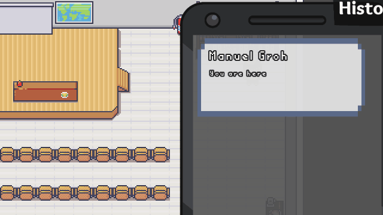

# THMastery

**A narrative no-combat CRPG set on the THM campus in Gießen.**

## Trailer

https://github.com/user-attachments/assets/7b968190-f7be-47ed-b0b0-be96049a4204

## About

**THMastery** is a 2D narrative CRPG inspired by *Disco Elysium*. You play a new student at THM whose studies, conversations and decisions determine which paths through the game are available.

> **Status:** playable vertical slice / prototype

## Features

### Dialogue and choices
- Branching conversations where choices change **NPC affinity** and how characters react later on.
- Tasks with **multiple solutions**: talk your way through, use the right item, or find another route by exploring.

The systems support this, but the vertical slice only uses it in a few places.

### Character
- **Ten attributes** define what your character is good and bad at.
- **Nerve** replaces health: stress wears it down, while sleep, food and other activities restore it.

### Skill checks
- Every check tests one attribute and is resolved with a **D20 roll** plus modifiers.
- **Active checks** are picked by the player. A tooltip shows the success chance, the required roll and every modifier before you commit.
- **Passive checks** fire automatically when your character is skilled enough to notice something others would miss.

### Equipment and items
- **27 outfits, 13 hats** and face accessories that change both your look and your attributes.
- **Trinkets** that boost your attributes.
- Consumables, readable documents and vendors spread across the campus.

### Exploration
- A hand-built campus with NPCs and hidden items.

## Current demo

The current build is a vertical slice around the start of the game. It includes:

- a tutorial area that teaches movement, dialogue, tasks, items and checks;
- the ground floor of one university building, with its main hall, the cafeteria and a pasta bar;
- a small outdoor area around that building with side content, a vendor and hidden items;
- a few example tasks that can be solved through dialogue, items or exploration;
- menus for attributes, tasks, inventory, skills and options, plus the HUD.

The demo covers the beginning of the game. The rest of the campus and the main story are not part of it yet.

## Download

1. Download `THMastery_Windows.zip` from the [latest release](https://github.com/Thodorr/thmastery-showcase/releases/latest).
2. Unzip it and start `THMastery.exe`. No installation is required.

> **Note:** The executable is not code-signed, so Windows SmartScreen may show a warning on first launch. Choose **More info → Run anyway**.

## Controls

THMastery can be played almost entirely with the mouse.

| Input | Action |
| --- | --- |
| Left mouse button | Move, interact, select |
| Right mouse button | Inspect an object or use an inventory item |
| Hold left mouse button | Open the context menu for an object |
| `T` | Open tasks |
| `I` | Open inventory |
| `C` | Open attributes |
| `K` | Open skills |
| `Esc` | Open game menu |
| `Space` | Select the default dialogue option |

## Technology

- **Godot Engine 3.5** with **GDScript**
- **Dialogic 1.4.5**, extended for THMastery's dialogue and skill-check systems (custom choice buttons with check labels, probability tooltips and dice animation)

## Documentation

- **Game Design Document:** [docs/GD-Dokument_THMastery.pdf](docs/GD-Dokument_THMastery.pdf)

## Assets and licences

THMastery uses third-party assets, primarily from LimeZu's *Modern* collections. These assets have their own licence terms and are not automatically covered by a licence for this repository's source code.

Before redistributing the project, please check the terms for all included assets and keep the corresponding credits and licences with the project.
